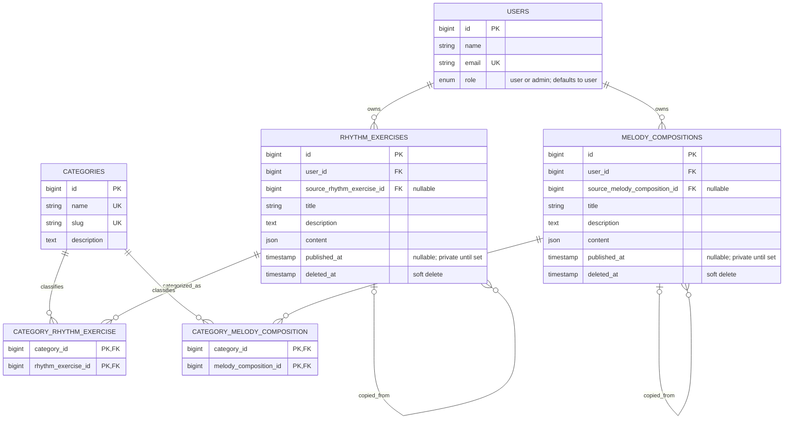

# Database schema

The initial schema separates rhythm exercises from melody compositions. Each editor stores its evolving document as JSON; fields used for ownership, publishing, attribution, and library filtering remain relational.



## Design notes

- The `users.role` enum supports `user` and `admin`; new accounts default to `user`.
- Rhythm and melody editor state is stored as structured JSON so the editor can evolve without a migration for every note or beat. Frequently filtered fields stay in indexed relational columns.
- A non-null `published_at` marks a public composition. New compositions are private; unpublishing clears the timestamp.
- Category joins allow a composition to have zero or more categories.
- A copied composition is a new, independently editable row. Its nullable self-reference preserves attribution; deleting the original permanently clears that reference.
- Compositions use soft deletion for later moderation and restoration. Categories and accounts are not soft-deleted in this initial schema.
- Deleting an account permanently cascades its compositions; deleting a category removes its category links. These actions are separate from the composition soft-delete workflow.
- `content` is the editor document, including rhythm/notation-specific values such as time signature, tempo, measures, notes, and rests. The application layer will validate its shape when the editors are implemented.
- The seeder adds one neutral `General` category and creates no default user account.

## Local database

Create a local MySQL database named `ritmakoks`, then configure `backend/.env` with its connection settings. Do not commit `.env`.

Run the schema and seed the default category:

```powershell
cd backend
php artisan migrate --seed
```

Reset a local development database and reseed it with:

```powershell
php artisan migrate:fresh --seed
```

`migrate:fresh` drops every table in the configured database; use it only with the disposable local development database.
